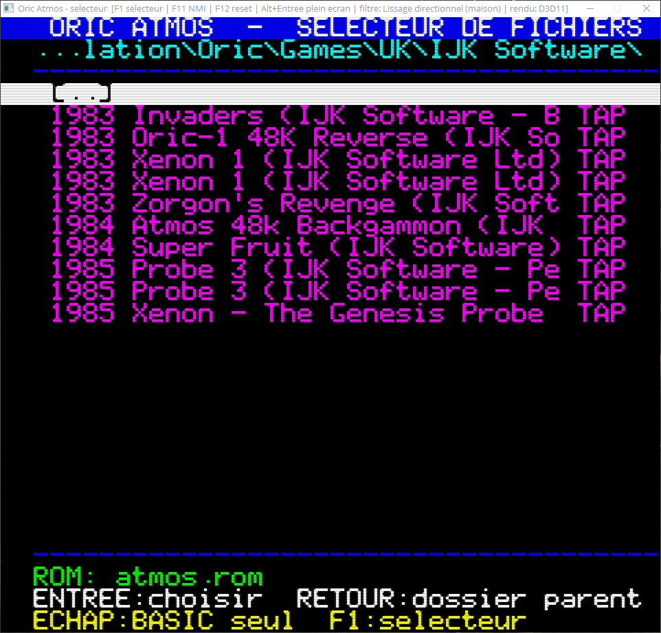
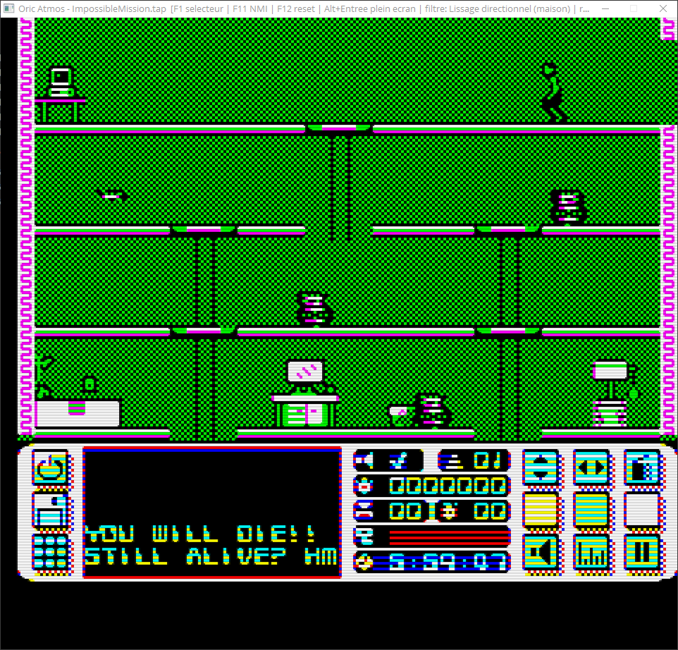

# Oric Emulator (C / Win32)

A lightweight, high-performance Oric-1 and Oric Atmos emulator written in pure C for Windows, featuring modern conveniences like CRT shaders, turbo tape loading, drag-and-drop support, and flexible ROM/keyboard configurations.

---

## 📸 Screenshots

| File Explorer / ROM Menu | Gameplay|
| :----------------------: | :-----------------------------------: |
|  |  |

---

## ✨ Key Highlights & Features

- **⚡ Lightweight & Fast:** Built in pure C using Win32 GDI. Starts instantly with zero bloated dependencies or heavy runtimes.
- **🚀 Turbo Tape Loading:** Accelerated tape loading with auto-start (`.tap`), allowing you to test programs and games instantly without waiting.
- **📁 Drag & Drop Support:** Drop any `.tap` tape or `.dsk` disk image directly onto the emulator window to load and boot it automatically.
- **📺 CRT Shaders & Scaling:** Authentic CRT scanline emulation and multiple high-quality smoothing filters.
- **🕹️ Controls & Remapping:** Joystick/gamepad support with per-game key remapping (saved locally per game).
- **⏱️ CPU Turbo Mode:** Speeds up execution while preserving original hardware interrupt timings.
- **💾 Settings Persistence:** All user preferences and configurations are saved in `settings.ini`.

---

## 🎛️ Built-in File Explorer & ROMs

Pressing **ESC** inside the emulator opens the built-in file explorer and ROM selector menu.

### Supported ROM Variations (`roms/`)
- **Atmos & Oric-1:** Authentic original system ROMs.
- **Fastboot / Slowboot:** Skip or perform memory checks on startup.
- **QWERTY / AZERTY:** Layout configurations for standard keyboards.
- **Accents:** Telestrat-style / Amstrad CPC-style accent character sets.

> ⚠️ *Note: Certain custom ROMs may break compatibility with specific classic titles.*

---

## 📂 Supported File Formats (`tapes/` & `dsk/`)
- **Tapes (`.tap`):** Includes classics like *L'Aigle D'Or*, *2048*, *Wizard's Lair (RogueLike)*, *4K Kong*, *Impossible Mission*, and *Stormlord*.
- **Disks (`.dsk`):** Supports disk images such as *Elite* and *L'Aigle D'Or*.

---

## 🛠️ Compilation & Building

To compile the project from source on Windows:

1. Install **MinGW-w64** (e.g., [mingw-builds-binaries](https://github.com/niXman/mingw-builds-binaries/releases)).
2. Run the build script:
   ```cmd
   build.bat
   ```
   Or via GNU Make:
   ```bash
   make
   ```
   *(The build automatically terminates running instances, compiles all C sources, embeds Windows resource icons and version info via `windres`, and launches `Oric.exe`).*

---

## 🗺️ Roadmap & TODO

- [ ] Extended key remapping interface for custom game controls.
- [ ] Gamepad/joystick configuration (global & per-game).
- [ ] On-screen HUD notifications for speed changes, filters, and snapshots.
- [ ] Fix window focus recovery after drag-and-drop operations.
- [ ] Quick scaling shortcuts (1x, 2x, 3x, 4x) & 4:3 / 1:1 aspect ratio toggle.

---

## 📜 License

Project distributed under open-source terms. See repository files for details.
